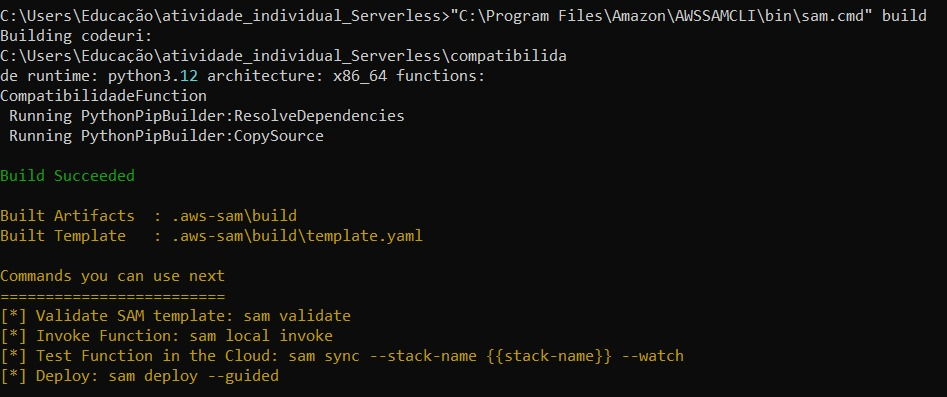
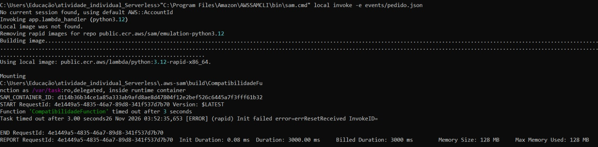
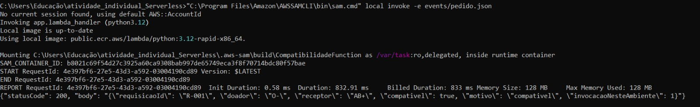
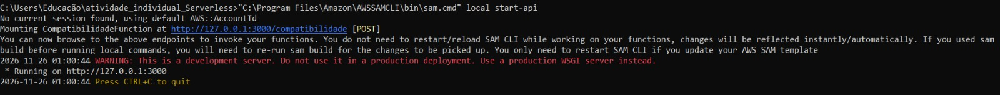
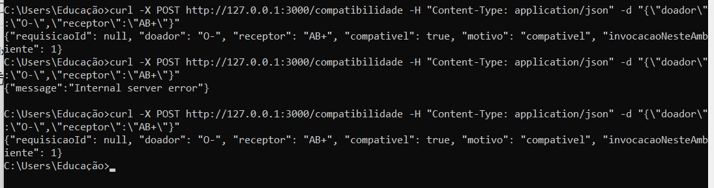
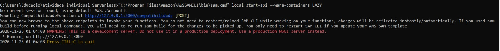
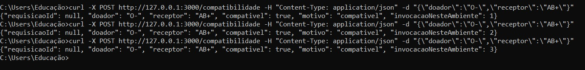
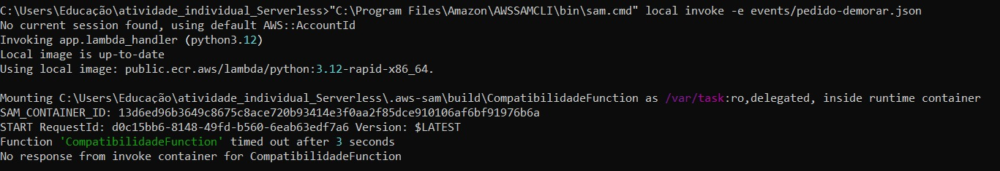
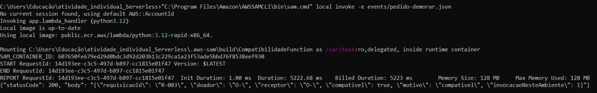

# Evidências — Serverless (SAM CLI local)

Função serverless que valida a compatibilidade ABO/Rh de uma requisição do Rota Vital, executada localmente com o AWS SAM CLI.

## E1 — Build

- [x] `sam build` concluído com sucesso.

## E2 — Invocação com evento

- [x] `sam local invoke` retornando `200` com `"compativel": true` e o campo `invocacaoNesteAmbiente`. A primeira invocação é mais lenta (cold start / construção da imagem); a seguinte reaproveita o ambiente.

## E3 — Gatilho HTTP sem reaproveitamento

- [x] `sam local start-api` + `curl` 3x **sem** `--warm-containers`: o campo `invocacaoNesteAmbiente` fica **sempre 1** — cada chamada roda num container novo e descartável.

## E4 — Gatilho HTTP com reaproveitamento

- [x] `sam local start-api --warm-containers LAZY` + `curl` 3x: o `invocacaoNesteAmbiente` cresce **1 → 2 → 3** — o container é reaproveitado e a variável global sobrevive. Prova que não se pode confiar em estado numa variável global.

## E5 — Limite de tempo (timeout)

- [x] Com `Timeout: 3` no `template.yaml`, o evento `pedido-demorar.json` (dorme 5s) é cortado: **"timed out after 3 seconds"**.

## E6 — Timeout ajustado

- [x] Após mudar o `Timeout` para `10` e refazer o `sam build`, a mesma chamada roda os 5s e retorna `200` (Duration ~5222 ms).

---

**Vídeo (até 3 min):** invocação com evento + chamada por HTTP (curl) + erro de tempo limite.
